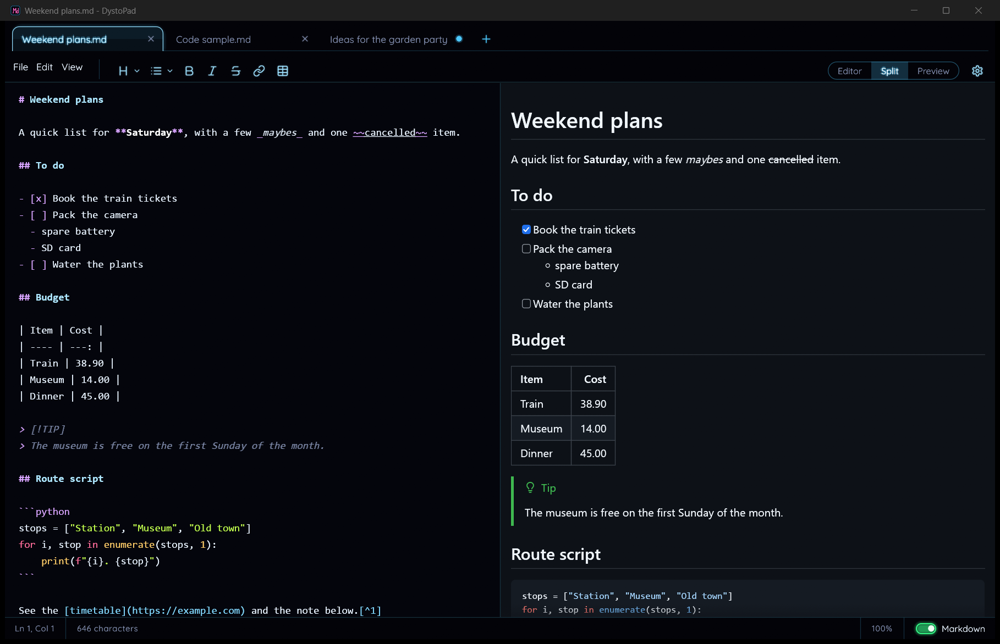

# DystoPad

A small notepad for the desktop, in the neon-on-black look of the Dysto apps, with a Markdown mode on top. Written in Rust with [egui](https://github.com/emilk/egui); it runs on Windows and Linux.



- **A plain notepad:** tabs, open and save, undo and redo, find and replace, go to line, word wrap, print and zoom. The status bar shows the line, column, character count and zoom.
- **Tabs stay open until you close them,** unsaved text included, even across restarts. An unsaved tab is named after its first words, as in Notepad. Files opened from Explorer ("Open with") or dropped on the window open as a new tab in the running window.
- **Markdown mode:** the **Markdown** switch in the bottom right turns a tab into a Markdown editor with highlighting, next to a live preview in GitHub's dark style. The switch at the top shows the editor, both, or only the preview; drag the line between them to resize. A format bar adds headings, lists, bold, italic, strikethrough, links and tables.
- **Markdown files** (`.md`) open as their preview. Saving suggests `.md` while Markdown mode is on and `.txt` otherwise.
- **English and German,** switchable under the gear icon.

## Install

Each [release](https://github.com/YodelingGoethe/DystoPad/releases/latest) has three downloads:

| File | For |
| --- | --- |
| `DystoPad_<version>_x64-setup.exe` | Windows, installed. Adds DystoPad to "Open with" for `.txt` and `.md` files, without changing your default apps. |
| `DystoPad_<version>_x64-portable.exe` | Windows, portable. No install: put it anywhere and run it. |
| `DystoPad_<version>_amd64.AppImage` | Linux. Make it executable (`chmod +x`) and run it. |

The app isn't signed, so Windows warns on the first start: "More info", then "Run anyway".

Coming from Dystonotepad? DystoPad takes over its open tabs, unsaved text included, the first time it starts.

## Using it

| Key | Action |
| --- | --- |
| Ctrl+N / Ctrl+T | New tab |
| Ctrl+O | Open |
| Ctrl+S / Ctrl+Shift+S | Save / Save as |
| Ctrl+W | Close tab (asks first if it has unsaved changes) |
| Ctrl+Tab / Ctrl+Shift+Tab | Next / previous tab |
| Ctrl+F / Ctrl+H | Find / Replace |
| Ctrl+G | Go to line |
| Ctrl+P | Print |
| Ctrl +/− / Ctrl+0, Ctrl+mouse wheel | Zoom in, out, reset |
| Tab / Shift+Tab | Indent / outdent the line or the selected lines |
| F11 | Fullscreen |

In Markdown mode:

| Key | Action |
| --- | --- |
| Enter | Continues a list, quote or checklist; Enter on an empty item ends it |
| Tab / Shift+Tab | Nests or un-nests a list item, from anywhere in it |
| Ctrl+B / Ctrl+I / Ctrl+K | Bold / italic / link |

The preview renders GitHub-flavored Markdown the way GitHub shows it: tables, task lists, strikethrough, footnotes, alerts (`> [!NOTE]`), bare links, and code blocks in GitHub's colors. Images and links relative to the file work, and web links open in the browser. HTML in a document shows its text and images. Printing opens the document in your browser, ready to print: Markdown as GitHub's light style, plain text as it is.

Files are read as UTF-8, UTF-16 (with a BOM) or, failing that, Windows-1252, and saved as UTF-8 with their original line endings (CRLF or LF).

## Build it yourself

You need the Rust toolchain ([rustup](https://rustup.rs)). Windows also needs the [Microsoft C++ Build Tools](https://visualstudio.microsoft.com/visual-cpp-build-tools/) ("Desktop development with C++"). On Debian or Ubuntu, install `libxkbcommon-dev libwayland-dev libx11-dev libxcursor-dev libxrandr-dev libxi-dev libgl1-mesa-dev libgtk-3-dev`.

```bash
cargo run              # the app
cargo test             # file decoding, Markdown parsing and editing, highlighting, search, printing
cargo build --release  # target/release/dystopad(.exe)
```

The Windows installer is built with [NSIS](https://nsis.sourceforge.io): `makensis /DVERSION=1.0.0 packaging\windows\installer.nsi`. The AppImage: `packaging/linux/appimage.sh 1.0.0`.

**Releases:** push a tag like `v1.0.0` (`git tag v1.0.0 && git push origin main v1.0.0`). GitHub Actions builds the three downloads above and publishes them on the Releases page. Versions are `major.minor.hotfix`.

[CHANGELOG.md](docs/CHANGELOG.md) lists what changed in each version, [STATUS.md](docs/STATUS.md) has the progress and next steps, and [CLAUDE.md](CLAUDE.md) the architecture notes. The look follows [Stylingguidelines.md](docs/Stylingguidelines.md), shared by all Dysto apps.

## License

DystoPad is free software under the [GNU General Public License v3.0 or later](LICENSE).

It includes the fonts [Quicksand](https://github.com/andrew-paglinawan/QuicksandFamily) and [Tilt Neon](https://github.com/googlefonts/Tilt-Fonts) under the SIL Open Font License (`assets/fonts`), icons from [Lucide](https://lucide.dev) (ISC License) and GitHub's [Octicons](https://github.com/primer/octicons) (MIT License), and [github-markdown-css](https://github.com/sindresorhus/github-markdown-css) (MIT License) for printing.
